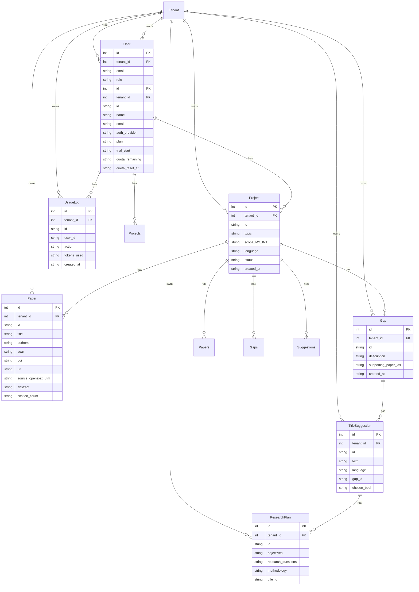

# Data model

Every table has an `id` and a `tenant_id`, and every query filters by the tenant. Add indexes for every list and search.

## User
- `id`: string
- `name`: string
- `email`: string
- `auth_provider`: string
- `plan`: string
- `trial_start`: string
- `quota_remaining`: string
- `quota_reset_at`: string
- has many Projects

## Project
- `id`: string
- `topic`: string
- `scope_MY_INT`: string
- `language`: string
- `status`: string
- `created_at`: string
- belongs to User
- has many Papers
- has many Gaps
- has many Suggestions

## Paper
- `id`: string
- `title`: string
- `authors`: string
- `year`: string
- `doi`: string
- `url`: string
- `source_openalex_utm`: string
- `abstract`: string
- `citation_count`: string
- belongs to Project

## Gap
- `id`: string
- `description`: string
- `supporting_paper_ids`: string
- `created_at`: string
- belongs to Project

## TitleSuggestion
- `id`: string
- `text`: string
- `language`: string
- `gap_id`: string
- `chosen_bool`: string
- belongs to Gap

## ResearchPlan
- `id`: string
- `objectives`: string
- `research_questions`: string
- `methodology`: string
- `title_id`: string
- belongs to TitleSuggestion

## UsageLog
- `id`: string
- `user_id`: string
- `action`: string
- `tokens_used`: string
- `created_at`: string
- belongs to User

